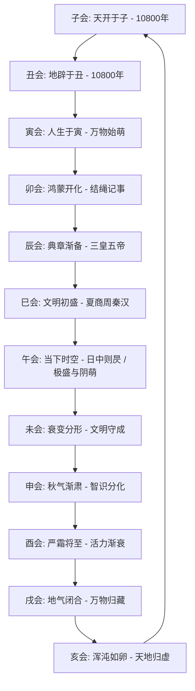

# 皇极经世 · 元会运世时空全息模型

> **理论宗本**：源自北宋理学家邵雍（康节先生）代表作《皇极经世书》。邵雍将《易经》象数与律历推步深度结合，创造了中国哲学史上规模最宏大、逻辑最严密的“宇宙大年”与人类历史周期演化模型。

---

## 🌌 一、元会运世：时空维度的四级全息嵌套

邵子认为，天地的运行与人事的兴衰，具有高度的周期全息对应性。正如一年有十二个月、一日有十二个时辰，宇宙整体的演变周期亦有“十二会”之大循环：

$$\text{1 元} = \text{12 会} = \text{360 运} = \text{4320 世} = \text{129,600 年}$$

### 1. 四级时空标尺与换算公式

| 层级名称 | 换算基数 | 折合年数 | 对应自然时辰 | 对应社会/生命周期 |
| :--- | :--- | :--- | :--- | :--- |
| **一世 (Generation)** | 30 年 | 30 年 | 一日之月相循环（30日） | 一代人之交替，政治代际更迭 |
| **一运 (Movement)** | 12 世 | 360 年 | 一岁之日数（360日） | 一个历史朝代或文化形态之盛衰 |
| **一会 (Epoch)** | 30 运 | 10,800 年 | 一月之辰数（360辰） | 一大冰期气候演进与人类主文明周期 |
| **一元 (Cosmic Cycle)** | 12 会 | 129,600 年 | 一岁之辰数（4320辰） | 天地开辟、化生、极盛至闭藏之“宇宙大年” |

### 2. 十二会的天地生灭法则

邵子以十二地支配十二会，揭示天地文明的十二阶段演进：

---

## 🧭 二、当代人类文明的时空位标推演

根据邵雍《皇极经世》历代推步：
1. **大周期（会）**：目前人类历史正处在**午会**（第七会）。午为正南方，离卦之位，象征人类文明发展到光辉照耀、科技与智识空前繁荣的顶峰；但“日中则昃”，阳极之中已有微阴萌生，面临资源、环境与心性失衡的严峻考验。
2. **中周期（运）**：处在午会的**大过运**至**鼎运**过渡阶段。大过为栋桡（结构承压、重负变迁），鼎为去故取新（文明重构、范式转换）。
3. **现代启示**：邵雍的时空观绝非悲观宿命论，而是提醒执政者与智者“察盛衰于萌芽，识进退于几微”，在盛极之时居安思危，行生生不息之天道。

---

## 💡 三、先天六十四卦方圆图的理数模型

邵雍将伏羲先天六十四卦排列为“外圆内方”图：
- **圆图主运行（时间）**：从正下方“地雷复”（冬至，一阳初生，天根）顺行左旋至乾卦，再由“天风姤”（夏至，一阴初生，月窟）逆行右旋至坤卦，完美呈现阴阳消长与四季冷暖之全息律动。
- **方图主定体（空间）**：乾坤定南北，坎离列东西，六十四卦按二进制自乘矩阵展开，呈现宇宙空间的秩序建构。

**核心心诀**：
> “天根月窟闲来往，三十六宫都是春。”  
> 懂得阴阳消长的临界点（复之天根、姤之月窟），便能在时空的大流转中保持从容自若的先机。
