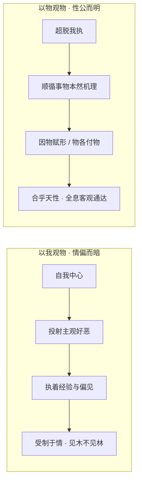

# 邵雍观物论 · 以物观物的客观认知模型

> **理论源头**：北宋哲学家邵雍《皇极经世·观物内篇》（观物篇五十一至五十三）。
> **核心命题**：“以物观物，性也；以我观物，情也。性公而明，情偏而暗。” 这一命题被现代哲学家与系统学家视为超越主客二元对立、破除确认偏误（Confirmation Bias）的高阶认知心法。

---

## 🧠 一、“以我观物”与“以物观物”的双重认知范式

邵雍在《观物篇五十三》中，将人类看待世界的视线与思维方式划分为两个截然不同的境界：

### 认知对比矩阵

| 维度 | 以我观物（主观情绪投射） | 以物观物（客观全息洞察） |
| :--- | :--- | :--- |
| **认知基点** | “我”是世界的绝对中心与裁判者 | “物”各有其独立存在与自洽规律 |
| **心性状态** | **情**（私意、执念、情绪冲动） | **性**（清明、本真、至公至正） |
| **思维盲区** | 容易陷入“确认偏误”与“信息茧房” | 破除自我偏见，容纳全局与反例 |
| **决策结果** | 盲目跟风、任性而动，常常始吉终凶 | 顺天应物，在变易中把握“不易”常道 |

---

## 👁️ 二、“反观”心法：四重感知与信息全息整合

邵雍在《观物篇五十二》中探讨了人体结构与外在物象的精密对应：
- **目之于色**（太阳之光感）
- **耳之于声**（太阴之韵律）
- **鼻之于气**（少阳之升降）
- **口之于味**（少柔之滋养）

邵子指出，普通人仅停留在“用眼看色、用耳听声”的初级感官层面，而真正的圣人与智者，则能实现**“反观”**：
> “不以我观物者，以物观物之谓也。圣人之所以能一万物之情者，谓能反观也。反观者，以物观物，而不以我观物也。”

所谓“反观”，即跳出自我的主观视阈，站在事物自身的立场与时空处境来审视事物：
- 观察水，顺水之流势与润下之性；
- 观察人，体察其身世处境与心性诉求；
- 观察时势，体察其周期运行与转折几微。

---

## 🚀 三、现代场景应用与实践转化

### 1. 商业战略与投资决策
- **以我观物之害**：因为自己投入了大量资金（沉没成本），便一厢情愿地认为市场会按自己的预期反弹；
- **以物观物之明**：放下个人执念，客观分析供需关系、用户真实痛点与宏观经济周期。若大势已去，果断顺应市场调整，不与趋势为敌。

### 2. 组织管理与识人用人
- **因材器使（物各付物）**：邵雍认为万物各有所长，亦各有所短。管理不应强求所有人如“我”一般思考，而应识别每位成员独特的“性”与“才”，将其置于最适宜的岗位。

### 3. 心性修养与情绪调适
- 当遭遇挫折与逆境时，若“以我观物”，必怨天尤人、焦虑内耗；若“以物观物”，则知盛极必衰、剥极必复，明白困厄本是人生周期必经之一环，从而在泰然处之中心平气和。
