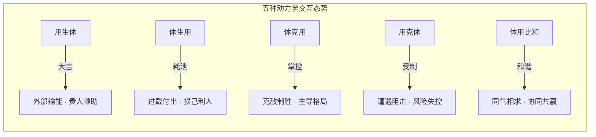

# 梅花易数 · 体用生克与心易时空感应模型

> **理论宗本**：源自北宋邵雍《梅花易数·卷二》“体用总诀”与《卷三》“三要十应”。
> **哲学本质**：梅花易数将纷繁复杂的现实世界抽象为“体”（主体/我方）与“用”（客体/外物/环境），通过本卦、互卦、变卦的动态演进，揭示系统内生与外应之间的全息共振规律。这不仅是占卜技法，更是一套极其精微的**主客体博弈动力学**与**全息同步性（Synchronicity）认知模型**。

---

## ⚖️ 一、体用生克动力学：系统主客互动的五种态势

在梅花易数中，卦象被解构为**静（体卦）**与**动（用卦）**：
- **体卦**：代表当事人、核心诉求、项目本体、内在根基，守位而不动；
- **用卦**：代表外界环境、突发事件、对手、外来干涉，因动爻而生变。

### 现代管理与决策映射表

| 格局 | 五行关系 | 现实博弈情境 | 决策战略建议 |
| :--- | :--- | :--- | :--- |
| **用生体** | 外部生助我方 | 政策红利、资本加持、市场刚需爆发 | **乘势而上**：果断扩大战果，整合外源力量 |
| **体克用** | 我方压制外部 | 技术壁垒高、谈判话语权强、掌控对手 | **稳健推进**：乘胜追击，但须防用力过猛 |
| **体用比和** | 双方同气相求 | 资源互补、合伙默契、文化价值同频 | **协同共进**：巩固联盟，追求共赢成果 |
| **体生用** | 我方持续消耗 | 沉没成本过大、补贴战、精力透支严重 | **止血止损**：控制资源耗散，避免被动拖垮 |
| **用克体** | 外部打压我方 | 监管收紧、竞争对手围剿、严重内耗 | **退守自保**：潜龙勿用，规避锋芒以待转机 |

---

## ⏳ 二、本·互·变演进链：事态全生命周期推演

梅花易数绝不孤立地看一个卦，而是通过**“本卦—互卦—变卦”**三位一体，还原事物发展的时间全景：

$$\text{本卦（事之发端/当下现状）} \longrightarrow \text{互卦（隐秘过程/中间阻力）} \longrightarrow \text{变卦（最终结局/长远趋势）}$$

1. **本卦（Initial State）**：表征事情发生当下的形态与主客初始强弱；
2. **互卦（Process & Hidden Factors）**：由本卦的二三四爻（下互）与三四五爻（上互）组合而成，表征事情在台面下暗中酝酿的推手、隐蔽危机或转圜契机；
3. **变卦（Final State）**：动爻阳变阴、阴变阳后形成的最终卦象，表征尘埃落定时力量对比的重构。

**经典案例启迪**：
若本卦“用克体”（起步艰难），但互卦转为“比和”（中途得强援调停），最终变卦转为“用生体”（终局大获成功），则智者虽临危而不乱，知晓熬过初期困厄必有后福。

---

## 🌐 三、三要十应：全息共时性（Synchronicity）的东方模型

荣格（Carl Jung）晚年通过研读《易经》，提出了著名的心理学概念——**“共时性（非因果性联系原则）”**。而早在千年前，邵雍就通过“三要十应”将这一宇宙法则推演至极妙化境：

### 1. 三要（内观心法）
- **耳闻其声**：听声音之清浊、抑扬、喜怒；
- **目见其色**：观物象之圆缺、动静、光暗；
- **心领其神**：刹那间心念之感通，无私意妄断，即境起智。

### 2. 十应（外应全息场）
当占事之时，外界偶然发生的伴随事件，并非孤立随机的巧合，而是当下“时空场”信息的一体全息投射：
- **天时之应**：言喜事而忽现彩虹、骄阳，吉兆彰显；论危机而骤降狂风骤雨，警示在前；
- **地理之应**：身处平坦大道，谋事顺遂；临于坎坷危地，行路须慎；
- **物象之应**：忽闻鸟鸣求偶，婚事易成；偶见陶器破裂，契约有隙。

**认知终极心法**：
> “物之动也，以数示机；心之动也，以神应微。道不离物，微显阐幽。”  
> 真正的易学不是占卜过去未来，而是训练一颗**随时与天地万物处于敏锐共振、深度客观连接的至清至明之心**。
