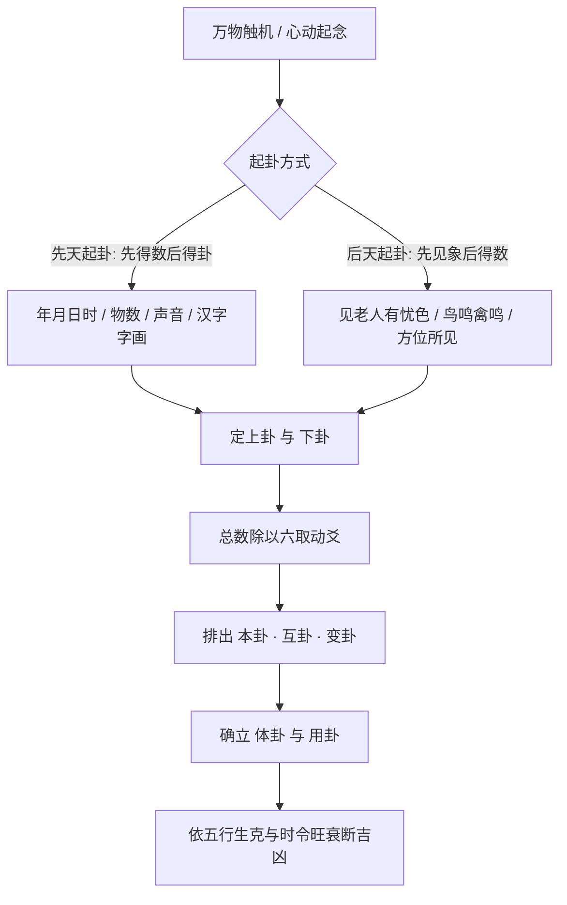

# 梅花易数 · 导读与研习指南

> **学术与术数地位**：相传为北宋易学大师邵雍（康节）先生所创，是中国传统易学占筮史上与汉代焦京汉易、唐宋六爻纳甲并立的灵动心易流派。
> **核心特色**：“不动不占，不因事不占”。不藉蓍草龟甲之繁，触机而发，见物即起卦，取数即定爻。体用分明，生克直捷。

---

## 📜 黄宗羲原序

序

---

## 🧭 一、梅花易数核心起卦心法矩阵

---

## ⚖️ 二、体用生克断法大则

- **体卦**：为主体、为我、为所求之主事，静而守位；
- **用卦**：为事端、为客、为外应时势，动而生变；
- **互卦**：事之中间过程、暗中隐伏之机理；
- **变卦**：事之终局、事态最终之落点。

| 生克格局 | 吉凶定断 | 现实事理映射 |
| :--- | :--- | :--- |
| **用生体** | 大吉，求之易得 | 得外力相助，贵人扶持，顺风顺水 |
| **体生用** | 耗泄，劳而少功 | 损己利人，付出巨大，心力交瘁 |
| **体克用** | 吉，克敌制胜 | 虽有阻力，但能掌控局势，胜券在握 |
| **用克体** | 凶，大受制约 | 遭外界压制打击，阻碍重重，败兆显露 |
| **体用比和** | 吉庆，谋为和谐 | 伙伴齐心，上下协力，安稳成就 |

---

## 📚 三、全书卷帙纲目

1. **[01_卷一_象数易理篇与起卦神断.md](file:///c:/Users/HiQhb/.gemini/antigravity-ide/scratch/yijing001/05_易学经典原典馆/05_梅花易数_邵雍/01_卷一_象数易理篇与起卦神断.md)**：先天卦数、年月日时起卦法、观梅占、牡丹占、借物占与八卦万物属类。
2. **[02_卷二_体用生克篇与分门占断.md](file:///c:/Users/HiQhb/.gemini/antigravity-ide/scratch/yijing001/05_易学经典原典馆/05_梅花易数_邵雍/02_卷二_体用生克篇与分门占断.md)**：心易占卜玄机、体用总诀、天时人事婚姻求谋二十门分占。
3. **[03_卷三_断占总诀篇与心易玄机.md](file:///c:/Users/HiQhb/.gemini/antigravity-ide/scratch/yijing001/05_易学经典原典馆/05_梅花易数_邵雍/03_卷三_断占总诀篇与心易玄机.md)**：八卦方位图、观物洞玄歌、花押字画断法、三要十应感应秘要。
