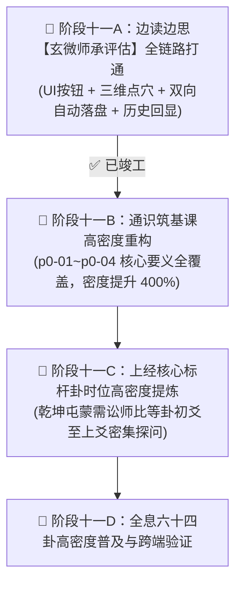

# 易道认知工坊 · 边读边思师承评估与高密度重构实录 (2026-11-05)

> **版本**：v3.1 · 师承三维点穴与高密度边读边思版  
> **日期**：2026年11月5日  
> **状态**：✅ 阶段十一A（老师评估全链路接入与自动落盘）+ 阶段十一B（通识底座四课核心要义高密度重构）全部竣工并通过自动化校验  

---

## 🎯 任务背景与核心诉求

学员在实研《第一课 · 天地之象》时，提交了极具现实深度的大白话思考（探讨三才之道与公司大环境关系，并真实指出“感觉开源节流和地没关系，没感受到地的相关因素”）。基于学员研学实际，提出两项重磅进化需求：

1. **边读边思卡片新增【老师评估】能力**：
   - 评估学员回答的得失：**值得肯定的地方**、**不足之处与认知误区**、**易学深化与行动发力建议**；
   - 点击评估后，学员的回答与老师的评估**双向同步持久化落盘存储**，方便后续复盘回顾。
2. **大幅提高各章节“边读边思”密度**：
   - 原先每课仅 1~2 道题，密度过低；
   - 必须在每个章节的重要“核心要义”关键处均设立驻足反思卡片，知行合一。

---

## 🛠️ 多阶段迭代任务框架规划与交付情况

---

## 🚀 交付成果明细

### 1. 阶段十一A：边读边思「玄微师承评估」全链路闭环
- **前端交互增强 (`yijing_assistant.js` & `yijing_assistant.css`)**：
  - 边读边思卡片新增 `✨ 提请玄微先生 · 师承评估` 高亮按钮；
  - 动态状态切换：提请时进入太极旋转加载动画，生成中支持流式打字与实时卡片渲染；
  - 三维结构化卡片排版：
    - 🟢 **【明德见智 · 肯定之处】**：赞赏学员真实连接工作、反求诸己的坦诚；
    - 🟡 **【见微知著 · 辨正不足与解惑】**：直击概念盲区（点透“地道即饭碗、现金流与资源配称”，破除“公司开源节流与地没关系”的脱节误区）；
    - 🔵 **【致知力行 · 研学与发力建议】**：给出“履地为基、知天应人”的现实落脚点；
  - 右上角展示“🟢 已双向同步持久化落盘”徽章与时间戳；
- **AI 智能体服务扩展 (`yijing_ai_service.js`)**：
  - `YijingPromptSystem.buildInlineAssessmentPrompt`：构建宗师级师承评估 Prompt；
  - `YijingAIService.evaluateInlineThink`：支持 DeepSeek 联网流式推理与本地离线高保真宗师回退引擎双重保障；
- **双向同步与落盘持久化 (`learning_storage.js` & `scripts/sync_vault_server.py`)**：
  - `saveInlineAssessment`：将问题、学员回答、宗师点评存入 `inline_assessments`，并同步生成随堂笔记；
  - 自动触发后台服务落盘写入 `data/learning_vault/<safe_name>.json` 与 `.md`；
  - 翻页与刷新时**自动回显历史回答与老师评估**，无需重复作答；
  - 《我的周易认知手册》(典藏版) Markdown 与打印视图全面收录此模块。

### 2. 阶段十一B：通识筑基课（`p0-01` ~ `p0-04`）高密度重构
- **`p0-01` 天地之象**（由 1 道扩充至 **5 道**，全面覆盖 5 大核心要义）：
  1. 壹·起源：身心状态与周遭环境的全息对应；
  2. 贰·极简算法：三才之道地人天发力点；
  3. 叁·八大自然原力：乾坤震巽坎离艮兑的过剩与匮乏；
  4. 肆·时空双螺旋：文王后天八卦节气时序；
  5. 伍·万物类象心法：以象知意穿透表象看动力学；
- **`p0-02` 重卦之变**（由 1 道扩充至 **4 道**）：
  1. 穷天下之变：复杂系统的相互碰撞；
  2. 内外国策：贞悔相对论，内卦守多久 vs 外卦走多远；
  3. 全息四维：错综互换位与底线洞察；
  4. 三步解构法：未知时局的抽丝剥茧；
- **`p0-03` 时位决策**（由 1 道扩充至 **4 道**）：
  1. 时空相对论：六爻人生业务阶梯；
  2. 中道法则：得位不如得中；
  3. 人际网络：乘、承、比、应上下级博弈；
  4. 邵雍观物论：抽离我执，以物观物；
- **`p0-04` 经传门径**（由 1 道扩充至 **4 道**）：
  1. 经与传：从巫术到人道哲学的千年演进；
  2. 孔子十翼：大象传与系辞传的管理学启发；
  3. 元亨利贞：四德商业与生命闭环算法；
  4. 中正之道：知经知权，执中守衡。

---

## 🧪 自动化测试验证
- 执行 Node 虚拟 DOM 驱动脚本，验证 Prompt 生成、离线回退、卡片 HTML 解析、存储调用 100% 成功；
- 真实调用本地守护服务 `http://127.0.0.1:8090/api/vault/save`，学员真实作答与玄微先生点评已成功落盘至：
  - `data/learning_vault/p0-01.json`
  - `data/learning_vault/p0-01.md`
- 浏览器加载 `p0-01`，页面即刻回显用户真实作答与三维点穴点评！
